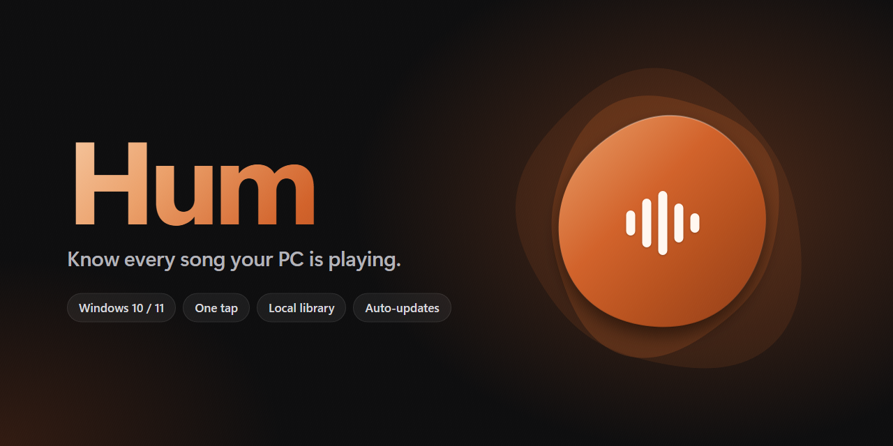
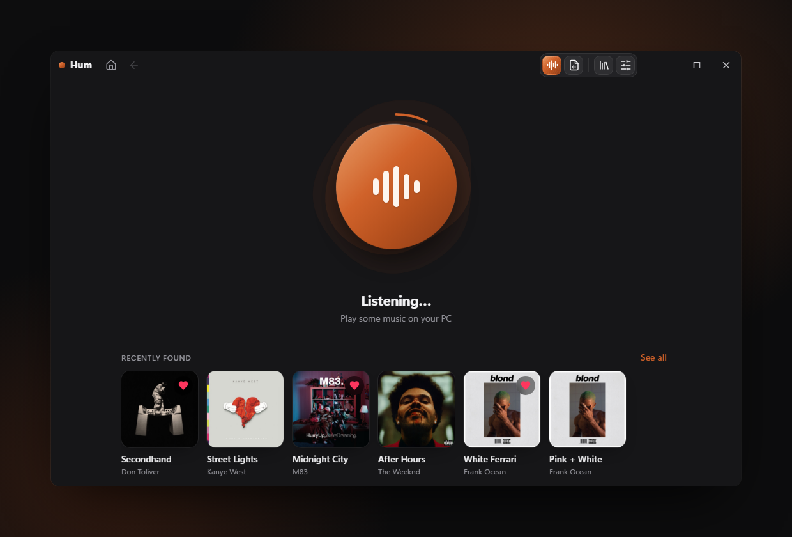
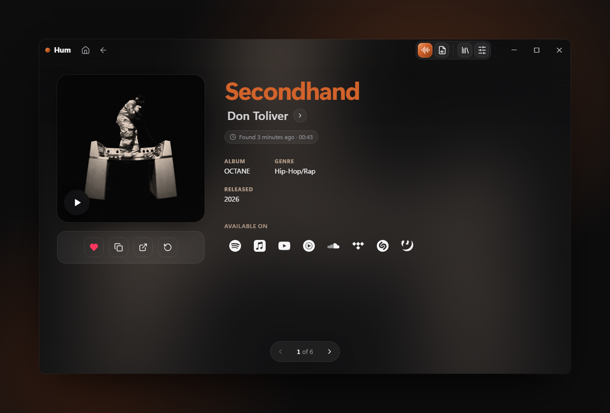
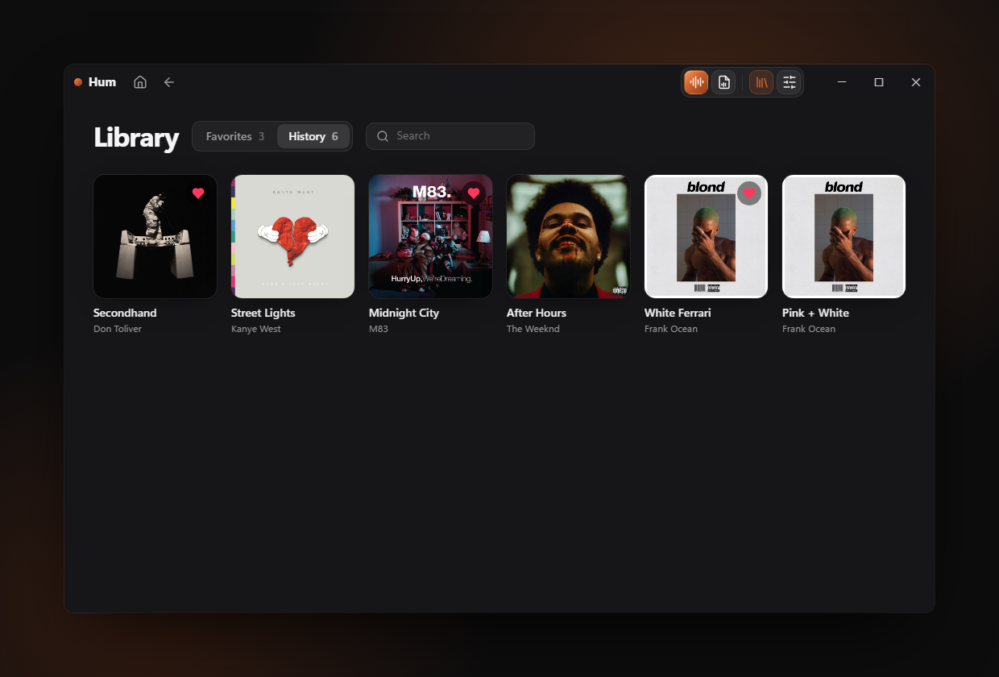

  <a href="https://github.com/aywalh/Hum/releases/latest"><b>⬇ Download for Windows</b></a>
  &nbsp;·&nbsp; Windows 10 / 11 &nbsp;·&nbsp; free

## What it does

Tap the bubble and Hum listens to whatever your PC is playing. That can be Spotify, YouTube, a game or a stream. A few seconds later you get the song. You can also drop in an audio or video file.

- **One tap.** No mic needed. Hum hears your PC's own sound.
- **Song page.** Cover, album, genre and a 30 s preview, with one-click links to Spotify, Apple Music, YouTube and more.
- **Local library.** Your favorites and history are saved on your PC, nowhere else.
- **Updates itself.** New versions download in the background and install on restart.

## Install

1. Download `Hum-Setup-x.y.z.exe` from [Releases](https://github.com/aywalh/Hum/releases/latest).
2. Run it. Windows may show “Windows protected your PC”. If it does, click **More info → Run anyway**, because the app isn't code-signed.
3. That's it. Later versions arrive automatically.

## Privacy

Only a short audio fingerprint is sent for recognition, never the sound itself. Your library never leaves your PC.

---

© aywalh. All rights reserved. Hum is not affiliated with Shazam or Apple.
